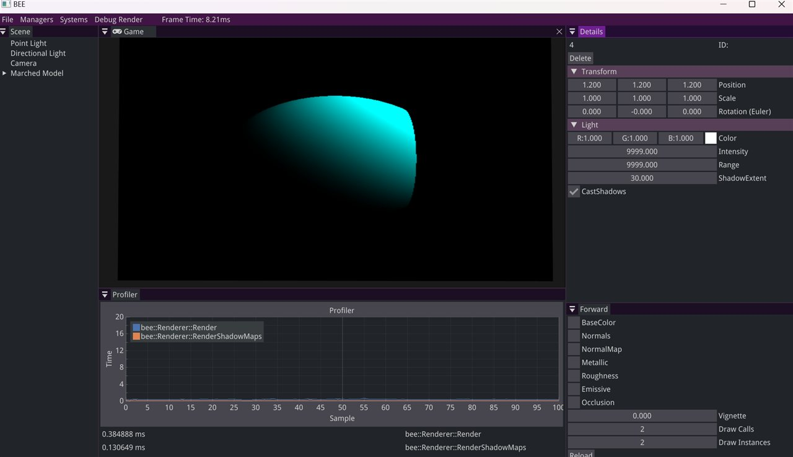
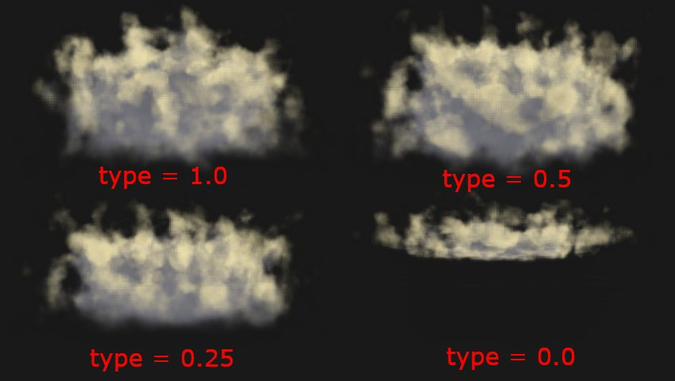
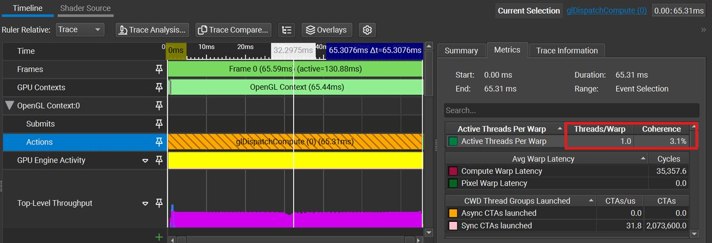

In my second year studying at BUas, I worked for 8 weeks on a self-study project. The assignment we were given gave us complete freedom in our choice of topic, and only limited us in time and complexity. After deliberating for a while on what topic to explore, I chose to try myself at graphics programming with Volumetric Cloud Rendering. 

<fieldset markdown="1">

<legend style="font-size: 1.5em;">My Work</legend>

 - Custom Ray Marching
 - Low-level graphics optimizations
 - Procedural cloud shapes from Perlin and Worley noise

Read More

The main inspiration for this project, was Guerrilla's Volumetric Clouds from Horizon: Zero Dawn and Horizon: Forbidden West and a very nifty article on the system the developed for these games: [Nubis³](https://www.guerrilla-games.com/read/nubis-cubed).

I dove more into the implementation and design of this this Blog Post: [Attempting Volumetric Clouds from Scratch](/blogs/cloud-rendering).

The approach I took, I heavily based on Nubis³. Choosing this this project to focus on a study of ray-marching. I also chose to do this entirely in a custom engine, to not get side tracked by getting acquainted with a new work environment or game-engine (since I haven't had any custom graphics experience in Unreal or Unity). 

My starting point was a light weight custom engine written in C++, that I had previously used in my time at BUas. 

Personally, I had very little experience in graphics programming prior to this project. I only made a simple 3D OpenGL Renderer, and a simple voxel ray-tracer, in my 1st year at BUas before looking into this, but I desperately wanted to broaden my horizons. 

</fieldset>

<fieldset markdown="1">

<legend style="font-size: 1.5em;">Ray Marching</legend>

*Placeholder.* I started by ray marching simple signed distance fields in a compute shader to get the pipeline working, then moved to marching through a voxel grid of cloud density, taking light samples towards the sun at each step.

</fieldset>

<fieldset markdown="1">

<legend style="font-size: 1.5em;">Cloud Shapes</legend>

*Placeholder.* The cloud density is built from layered Perlin and Worley noise and baked into the voxel grid. A single cloud type parameter blends between tall, puffy clouds and flat, thin ones.

<!-- TODO: final output GIF (D:\BUas\Year2\BlockB\2425-Y2B-PR-230704\evidence\assets\media\proj_output\WK7_mile\pink_cloud_output_lowres.gif) -->

</fieldset>

<fieldset markdown="1">

<legend style="font-size: 1.5em;">Optimizations using DDA Traversal</legend>

*Placeholder.* DDA traversal steps each ray exactly from voxel to voxel instead of at a fixed distance, so empty space is skipped. Profiling the GPU showed low warp coherence and L2 hit rates, which I improved by reducing branching and rendering at quarter resolution.

</fieldset>