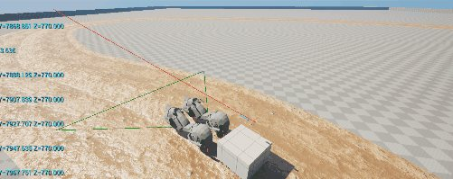
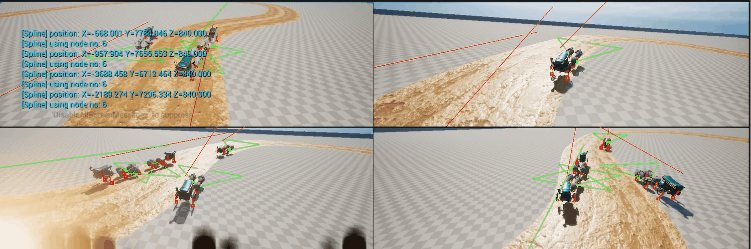
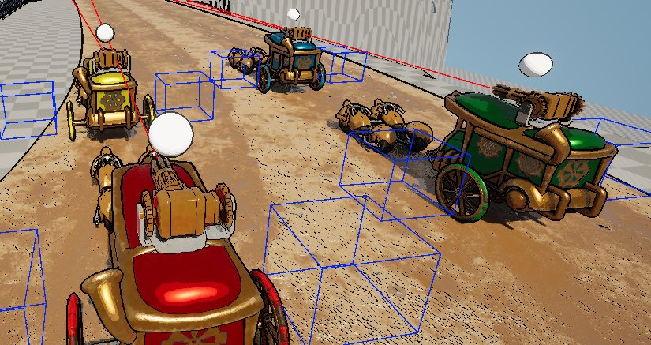

<iframe width="100%" style="aspect-ratio: 16 / 9;" src="https://www.youtube.com/embed/XiE5Psd2Xdc" title="Copper Clash" frameborder="0" allow="accelerometer; autoplay; clipboard-write; encrypted-media; gyroscope; picture-in-picture; web-share" referrerpolicy="strict-origin-when-cross-origin" allowfullscreen></iframe>
<fieldset markdown="1">

<legend style="font-size: 1.5em;">My Work</legend>

 - Shared local-multiplayer camera on splines (Blueprints)
 - Camera research and proofs of concept
 - Player colors and UI for local multiplayer

</fieldset>

*Copper Clash* is a local-multiplayer vehicle arena game, made by a multidisciplinary student team at BUas in Unreal Engine 5. My focus was the shared camera that keeps every player on screen, and the local multiplayer controls and UI. The game is free to play on [itch.io](https://buas.itch.io/team-pepper) (Windows, 2–4 players with controllers).

## Highlights

<fieldset markdown="1">

<legend style="font-size: 1.5em;">Camera Controller</legend>

*Placeholder.* The camera follows a spline laid along the track and picks its position from the nodes closest to the players, so every car stays in frame without split screen.

Read More

*Placeholder.* Camera research, comparing split screen with a shared camera, and the proofs of concept that led to the spline-based approach.

</fieldset>

<fieldset markdown="1">

<legend style="font-size: 1.5em;">Local Multiplayer Controls</legend>

*Placeholder.* Per-player colors so each player can find their car at a glance, a death warning icon when a player is about to leave the screen, and UI fixes.

</fieldset>
