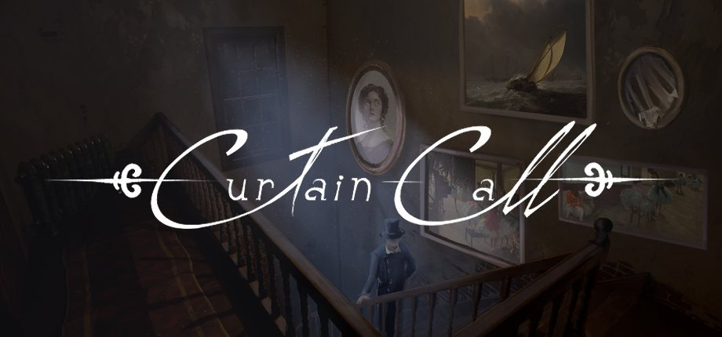
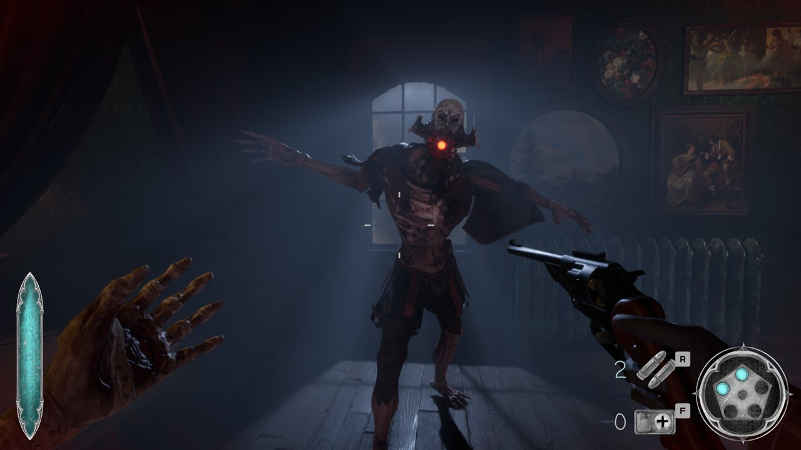
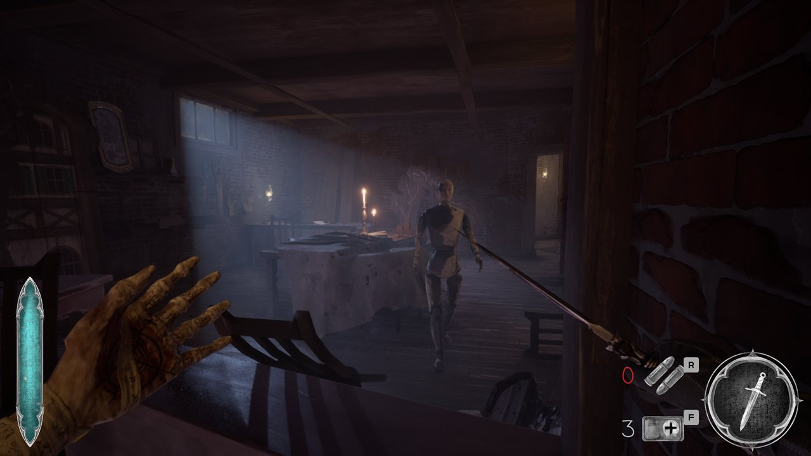

<iframe width="100%" style="aspect-ratio: 16 / 9;" src="https://www.youtube.com/embed/pMBV61Q5a1g" title="Curtain Call Cinematic Trailer" frameborder="0" allow="accelerometer; autoplay; clipboard-write; encrypted-media; gyroscope; picture-in-picture; web-share" referrerpolicy="strict-origin-when-cross-origin" allowfullscreen></iframe>
<fieldset markdown="1">

<legend style="font-size: 1.5em;">My Work</legend>

 - Stasis ability, built as a standalone Unreal plugin (C++)
 - Combat: melee hitboxes, input buffering, weapon refactor
 - Inventory and pickup systems
 - Lead programmer, CI/CD and Steam builds

</fieldset>

*Curtain Call* is a theatre-themed first-person action adventure, made by a multidisciplinary student team at BUas over three blocks of Year 3 and released on [Steam](https://store.steampowered.com/app/4515420/Curtain_Call/). Its core mechanic is a stopwatch that puts objects and enemies into stasis: freeze them, hit them to build up momentum, and release.

I started as a programmer on the stasis feature and combat, and in the final block took over full time as lead programmer and build owner.

<fieldset markdown="1">

<legend style="font-size: 1.5em;">Stasis Plugin</legend>

<!-- TODO: stasis clip (D:\BUas\Year3\BlockB\2526-Y3B-PR-230704\assets\media\ilo1\taskoutcome_wk3_stasishighlight.mp4) -->

I took over the stasis prototype and rebuilt it as a self-contained plugin: a `UStasisComponent` that any actor can opt into, and a `UStopwatchSubsystem` world subsystem that owns the player's stopwatch state.

Read More

*Placeholder.* Time slow while aiming, freezing multiple actors, indefinite freeze, passive recharge, momentum on release, and hooking stasis into the save/load system.

</fieldset>

<fieldset markdown="1">

<legend style="font-size: 1.5em;">Combat & Inventory</legend>

*Placeholder.* Templated inventory system, generic health and ammo pickups, melee re-integration with a hitbox rework and input buffering, weapons refactored with the Strategy pattern, weak spots, and the v1.0 combat encounters.

</fieldset>

<fieldset markdown="1">

<legend style="font-size: 1.5em;">Lead Programmer</legend>

*Placeholder.* Owned the CI/CD pipeline and Steam builds, restructured the depot, reworked the bug board and in-game bug report pipeline, and tracked down fatal errors in shipping builds for release.

</fieldset>
