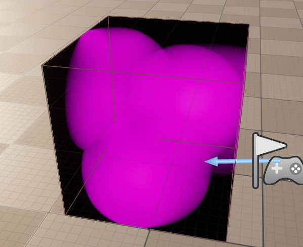
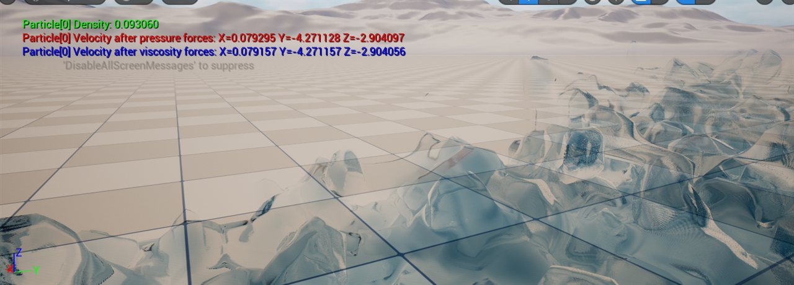
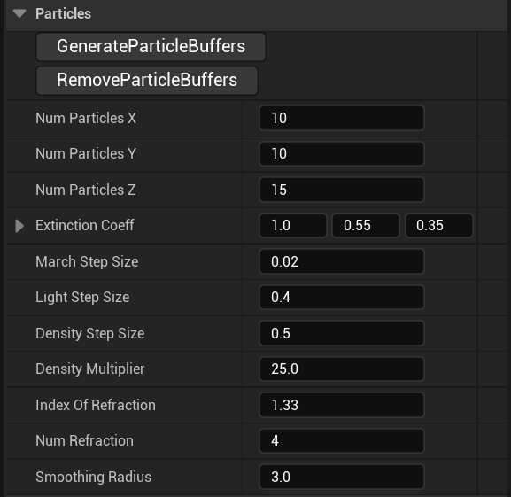



Worked with Robin Heijmans on Real-Time Particle Based Fluid Simulation in Unreal Engine 5. He worked on the particle fluid simulation, I developed the ray marched renderer. The result is packaged as a drop-in Unreal plugin.

<!-- TODO: replace with final video (D:\BUas\Year3\BlockA\2526-Y3A-PR-230704\evidence\assets\media\ilos\project\fluidmarch_wk8_final.mp4) -->

<fieldset markdown="1">

<legend style="font-size: 1.5em;">My Work</legend>

 - Ray marched fluid renderer (HLSL compute, Render Dependency Graph)
 - Live density map generation using spatial lookup
 - GPU buffer management and a SceneViewExtension pipeline
 - Packaging the simulation as an Unreal plugin

</fieldset>

<fieldset markdown="1">

<legend style="font-size: 1.5em;">Density Map</legend>

*Placeholder.* Every frame, the particle positions are splatted into a 3D density texture on the GPU, using a spatial lookup so each cell only checks nearby particles. Shrinking the map to 8-bit cut memory and bandwidth.

</fieldset>

<fieldset markdown="1">

<legend style="font-size: 1.5em;">Ray Marching</legend>

*Placeholder.* The renderer marches rays through the density map to find the fluid surface, then smooths the surface normals and shades it. Two-level view stepping keeps the step count low in empty space.

Read More

*Placeholder.* Why I dispatched the passes through a `SceneViewExtension` instead of `ENQUEUE_RENDER_COMMAND`, how simulation and rendering were separated, and the crashes and memory leaks fixed when creating multiple buffers.

</fieldset>

<fieldset markdown="1">

<legend style="font-size: 1.5em;">Unreal Plugin</legend>

*Placeholder.* The particle buffers live in a scene component, and the simulation and rendering parameters are exposed in the editor, so a designer can drop a fluid volume into any level.

</fieldset>
