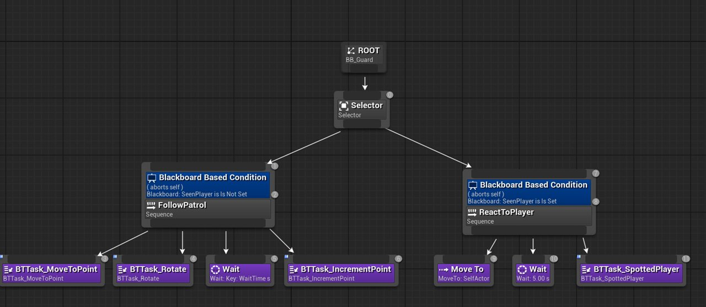
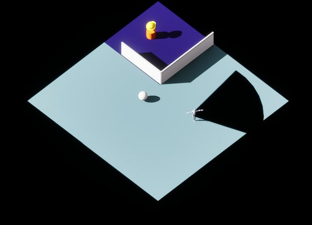

<iframe width="100%" style="aspect-ratio: 16 / 9;" src="https://www.youtube.com/embed/4voV9EgfXQo" title="Growth Plan Trailer" frameborder="0" allow="accelerometer; autoplay; clipboard-write; encrypted-media; gyroscope; picture-in-picture; web-share" referrerpolicy="strict-origin-when-cross-origin" allowfullscreen></iframe>
<fieldset markdown="1">

<legend style="font-size: 1.5em;">My Work</legend>

 - Player controller and camera controller
 - Patrol guard AI with Behavior Trees
 - Zone Tool for designers
 - Lead programmer, level streaming, Jenkins pipeline

</fieldset>

*Growth Plan* is a consequence-driven, light-hearted stealth puzzler about going to work and getting better at your job, played over a five-day loop. It was made in 8 weeks by a team of 5 at BUas in Unreal Engine 5, where I was lead programmer. The game is published on [itch.io](https://buas.itch.io/growth-plan).

<fieldset markdown="1">

<legend style="font-size: 1.5em;">Player & Camera</legend>

<!-- TODO: clip (D:\BUas\Year2\BlockD\2425-Y2D-PR-230704\evidence\assets\media\work\cameracontroller_screenbounds.mp4) -->

*Placeholder.* Point-and-click, then grid-based, player movement, and a camera controller with mouse and movement offsets and screen bounds.

</fieldset>

<fieldset markdown="1">

<legend style="font-size: 1.5em;">Patrol Guard AI</legend>

*Placeholder.* Rebuilt the patrol guards on an AIController and Behavior Tree, with view cones, a detection meter, and guards escorting the player out of restricted areas.

</fieldset>

<fieldset markdown="1">

<legend style="font-size: 1.5em;">Zone Tool</legend>

*Placeholder.* An editor tool that lets designers mark narrative-driven restricted areas, which drive guard behaviour and sabotage opportunities.

</fieldset>
