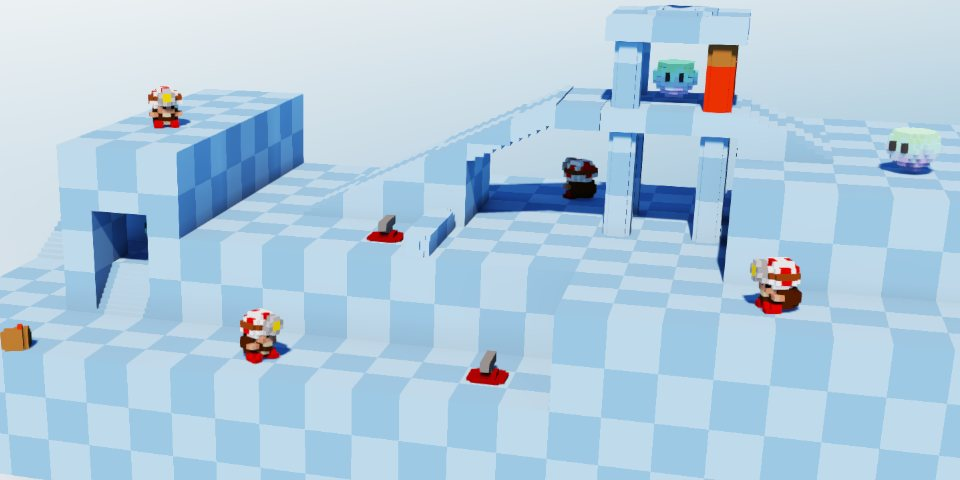
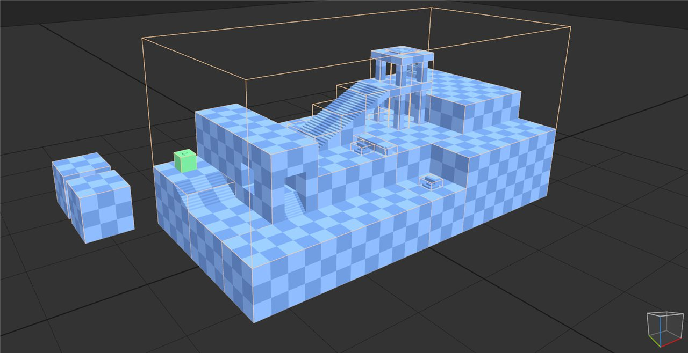
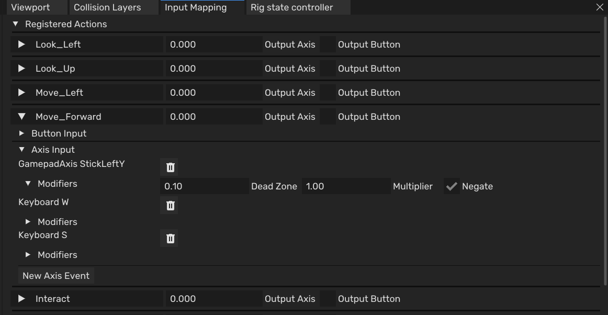
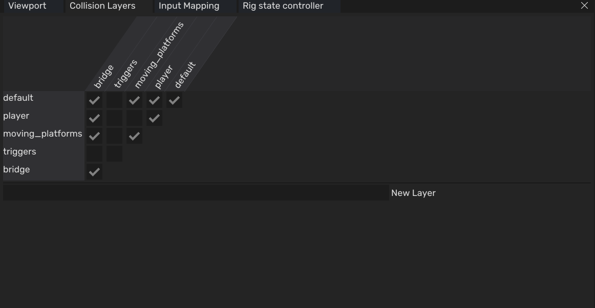

<iframe width="100%" style="aspect-ratio: 16 / 9;" src="https://www.youtube.com/embed/U1-4gV1Ww8M" title="Kudzu Puzzle Demo" frameborder="0" allow="accelerometer; autoplay; clipboard-write; encrypted-media; gyroscope; picture-in-picture; web-share" referrerpolicy="strict-origin-when-cross-origin" allowfullscreen></iframe>
<fieldset markdown="1">

<legend style="font-size: 1.5em;">My Work</legend>

 - Gameplay for the puzzle demo: player, camera, levels and UI
 - 3D character controller
 - Input mapping system (PC and PS5)
 - Physics collision layers and raycasts, with editor tools

</fieldset>

**Play as the Mushroom Man pulling levers and breaking stuff!**

The Kudzu Puzzle Demo is a small puzzle-adventure game made in Kudzu, a custom voxel engine built by a team of programmers at BUas over 8 weeks. The demo was inspired by Captain Toad: Treasure Tracker and was made to show off what the engine can do. I worked on the engine as a tools & gameplay programmer, and built the demo game on top of it.

The demo is free to play on [itch.io](https://tanyautor.itch.io/kudzu-puzzle-demo) (Windows, controller recommended).

## Highlights

<fieldset markdown="1">

<legend style="font-size: 1.5em;">Puzzle Demo</legend>

*Placeholder.* Three levels with a main menu and level select, a camera controller with zoom, lifts, punchable fences, a destructible bridge, collectibles, death screens and music, all scripted on top of the engine's gameplay API.

</fieldset>

<fieldset markdown="1">

<legend style="font-size: 1.5em;">Character Controller</legend>



*Placeholder.* A 3D character controller with movement states, friction, falling, ladders and smooth stair stepping.

</fieldset>

<fieldset markdown="1">

<legend style="font-size: 1.5em;">Input Mapping</legend>

*Placeholder.* An action and axis based input system with modifiers like dead zones and multipliers, an editor window with live action output, serialization, and backends for both PC and PS5.

</fieldset>

<fieldset markdown="1">

<legend style="font-size: 1.5em;">Collision Layers</legend>

*Placeholder.* A collision layer system with an editor matrix to choose which layers interact, and raycasts with layer masks exposed to scripting.

Read More



*Placeholder.* How the layers are stored, and how designers use them in the demo, for example for the moving platforms and the bridge.

</fieldset>
