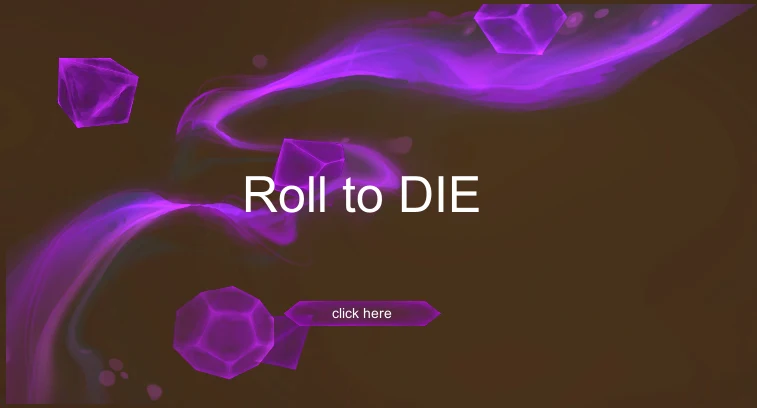
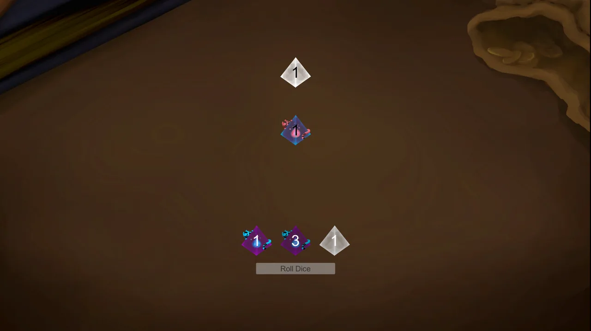
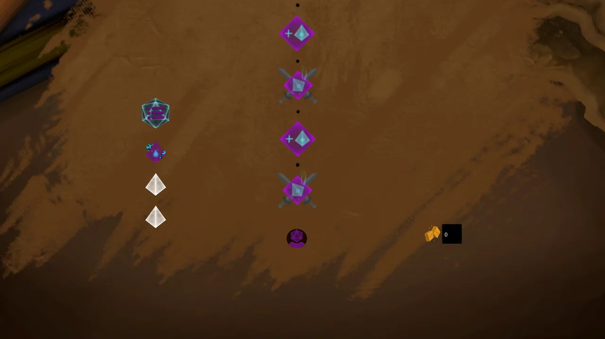
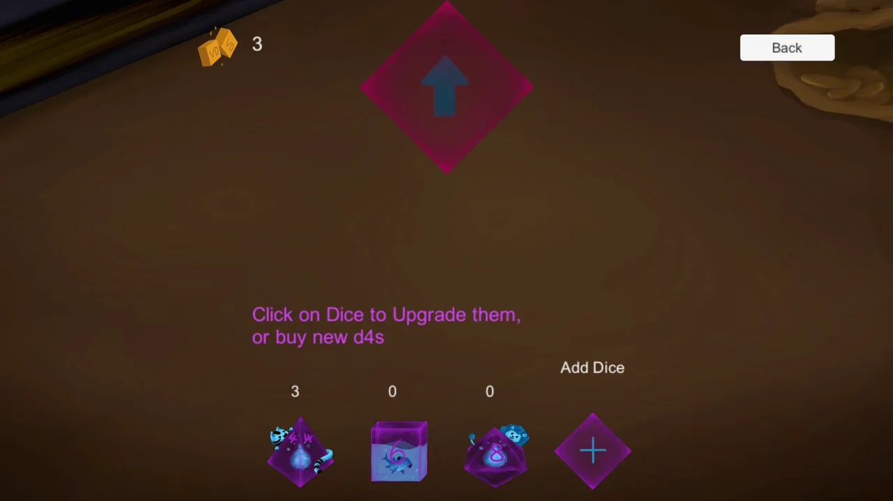

<fieldset markdown="1">

<legend style="font-size: 1.5em;">My Work</legend>

 - Roguelike map scroller (gameplay tool)
 - General programming support for the team
 - Made Smaller Node events from start to finish

</fieldset>

*Roll To Die* is a 2D roguelike strategy game made in Unity in only 48 hours for the [GMTK Game Jam 2022](https://itch.io/jam/gmtk-jam-2022). You fight your way through encounters and battle with a deck of dice. In game you roll the die and compare the faces with the enemy's to win or strategically lose to sacrifice a dice from your deck. It's free to play on [itch.io](https://emzph.itch.io/role-to-die) (Windows only).

The team was three designers, one 2D artist, and me as dedicated programmer, so besides my own features I also helped the rest of the team with programming during the jam. It was also my first project in Unity.

## Highlights

<fieldset markdown="1">

<legend style="font-size: 1.5em;">Map Scroller</legend>

A scrolling roguelike map, inspired by the map in *Inscryption*: the run is laid out as a path of encounter nodes, including: Battles, Item Shops, Gifts, and Dice rolling mini-games to gain Victory Points (to use in the Item Shop). The system made use of a linked list to chain nodes together, check for connections, etc.

</fieldset>

<fieldset markdown="1">

<legend style="font-size: 1.5em;">Shop & Node Events</legend>

Besides the map, I built the shop and several of the smaller node events, like the Item Shop, Gift event, and Dice rolling mini-game, from start to finish.

</fieldset>
